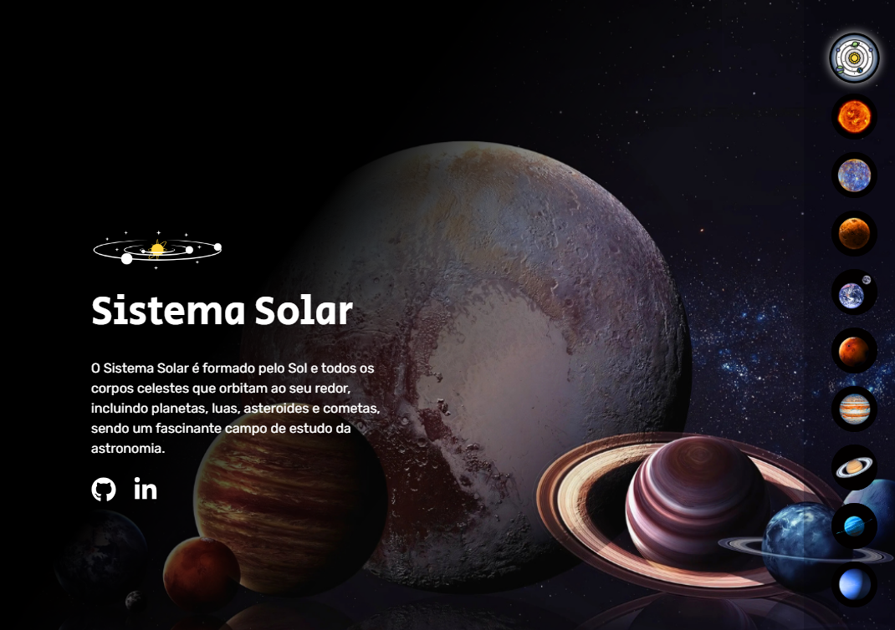

<div align="center">



<br><br>

# 🪐 O SISTEMA SOLAR · SELEÇÃO DE PLANETAS

**Dez botões, dez telas: do Sol a Netuno, um clique por astro.**<br>
HTML5 · CSS3 · JavaScript puro — sem frameworks, sem build.

<p>
  
  
  
</p>

<p>
  <a href="https://paulapsox.github.io/o-sistema-solar/">
    
  </a>
  <a href="https://github.com/paulaPSOx/o-sistema-solar">
    
  </a>
</p>

</div>

---

## ⚡ Em 30 segundos

| | |
| :-- | :-- |
| **O que é** | Página única com 10 telas em tamanho total: Sistema Solar, Sol e os 8 planetas (Terra e Lua aparecem juntas). Cada tela tem imagem, nome e descrição. |
| **Para quê** | Praticar seleção de elementos, troca de classes com JavaScript e layout com posicionamento fixo e responsivo. |
| **Destaque** | Um único `click` por botão liga o botão à tela de mesmo índice. O CSS decide o que aparece. |
| **Stack** | HTML5, CSS3 e JavaScript puro. |
| **Online** | [paulapsox.github.io/o-sistema-solar](https://paulapsox.github.io/o-sistema-solar/) |

---

## 🪐 Órbita: as telas

Os botões ficam na lateral direita, na ordem abaixo. Cada um abre uma tela:

| Botão | Tela |
| :-- | :-- |
| 1 | **Sistema Solar** (tela inicial) |
| 2 | **Sol** |
| 3 | **Mercúrio** |
| 4 | **Vênus** |
| 5 | **Terra e Lua** |
| 6 | **Marte** |
| 7 | **Júpiter** |
| 8 | **Saturno** |
| 9 | **Urano** |
| 10 | **Netuno** |

> 💡 **Dica para quem for testar:** clique nos botões da direita e veja o botão ativo crescer e ganhar brilho. Diminua a janela abaixo de 1024 px para ver os botões irem para o topo.

---

## 🌟 Descobertas desbloqueadas: funcionalidades

- 10 botões redondos com a imagem de cada astro, fixos na lateral direita.
- Ao clicar, a tela mostra imagem de fundo, logotipo, nome e uma descrição do astro.
- O botão ativo cresce 10% e ganha brilho.
- A página abre no Sistema Solar.
- Camada escura em degradê sobre a imagem para o texto ficar legível.
- Ícones do GitHub e do LinkedIn na tela.
- Layout adaptado a telas menores com media queries.

> **Observação:** a troca entre telas é instantânea, sem animação. Não há backend: os textos estão escritos direto no HTML.

---

## 🔧 Por dentro do código

Algumas decisões que tomei durante o desenvolvimento:

| Tema | Como foi resolvido |
| :-- | :-- |
| **Botão e tela ligados pelo índice** | `botoes.forEach((botao, indice) => ...)` usa o índice do botão para achar `planetas[indice]`. Por isso, os dois grupos precisam estar na mesma ordem no HTML. |
| **Estado com uma classe** | A classe `selecionado` marca o botão e a tela ativos. `desselecionarBotao()` e `desselecionarPlaneta()` limpam todos com `forEach` antes de marcar o novo. |
| **Mostrar e ocultar** | `.planeta` começa com `display: none` e `.planeta.selecionado` vira `display: block`. A imagem ocupa a tela com `object-fit: cover` e `height: 100vh`. |
| **Camadas** | `main::after` é um degradê fixo que escurece a imagem. `.conteudo` fica sobre ele (`z-index: 1`) e `.botoes` fica acima de tudo (`z-index: 100`). |
| **Logotipo** | Um elemento `<i class="logo">` recebe a imagem por `background-image` no CSS. |
| **Responsividade** | Abaixo de 1024 px, os botões passam para o topo em linha e o degradê fica vertical. Há ajustes também em 720 px, 620 px (botões quebram em linhas) e 425 px. |

### 🎯 Destaque: como um clique troca a tela

| Variável ou função | Papel no projeto |
| :-- | :-- |
| `botoes` | Lista dos 10 botões (`.botao`). |
| `planetas` | Lista das 10 telas (`.planeta`). |
| `indice` | Posição do botão clicado; é também a posição da tela a mostrar. |
| `desselecionarBotao()` | Tira a classe `selecionado` de todos os botões. |
| `desselecionarPlaneta()` | Tira a classe `selecionado` de todas as telas. |

---

## 🧬 Tripulação: tecnologias

<table>
  <tr>
    <td align="center" width="33%">
      <br>
      <strong>HTML5</strong><br>
      <sub>10 telas, botões reais (<code>button</code>) e <code>lang="pt-BR"</code>.</sub>
    </td>
    <td align="center" width="33%">
      <br>
      <strong>CSS3</strong><br>
      <sub>Camadas, posicionamento fixo e media queries.</sub>
    </td>
    <td align="center" width="33%">
      <br>
      <strong>JavaScript</strong><br>
      <sub>Eventos de clique e troca de classes.</sub>
    </td>
  </tr>
</table>

**Complementos:** Google Fonts (Rubik e Secular One), ícones SVG locais de GitHub e LinkedIn e hospedagem no GitHub Pages.

---

## 🗂️ Estrutura do projeto

```text
o-sistema-solar/
├── index.html                    # Página única com as 10 telas e os botões
├── background-o-sistema-solar.png # Print usado neste README
├── src/
│   ├── css/                      # style.css
│   ├── imagens/
│   │   ├── botao/                # Imagens dos botões redondos
│   │   ├── icones/               # GitHub e LinkedIn (SVG)
│   │   ├── logotipo/             # Logo e ícone do projeto
│   │   └── wallpaper/            # Imagem de fundo de cada tela
│   └── js/                       # index.js
├── LICENSE
└── README.md
```

---

## 🚀 Como rodar

Não há dependências nem etapa de build. Escolha uma das opções:

**Opção 1 — Acessar online:** [abrir no GitHub Pages](https://paulapsox.github.io/o-sistema-solar/).

**Opção 2 — Baixar o ZIP:** clique em **Code → Download ZIP** neste repositório, extraia e abra o `index.html` no navegador.

**Opção 3 — Clonar com Git:**

```bash
git clone https://github.com/paulaPSOx/o-sistema-solar.git
cd o-sistema-solar
```

Depois, abra o `index.html` no navegador. Se usar o VS Code, a extensão **Live Server** também funciona.

> As fontes do Google precisam de internet. As imagens de fundo são pesadas (somam cerca de 7,8 MB), então a primeira carga pode demorar.

---

## 📚 O que este projeto me ensinou

- Ligar dois grupos de elementos (botões e telas) pelo índice do `forEach`.
- Controlar o que aparece na tela com uma classe e regras de `display` no CSS.
- Sobrepor camadas com `position`, `z-index` e pseudo-elementos (`::after`).
- Adaptar um layout fixo para telas menores com media queries.

---

## 🏁 Próximas fases

Melhorias que quero fazer, e que **ainda não estão implementadas**:

- [ ] Corrigir o seletor `.main` nas media queries de 720 px e 620 px (o elemento é a tag `main`, não uma classe).
- [ ] Criar uma transição suave entre as telas (fade com `opacity`).
- [ ] Carregar as imagens de fundo só quando necessário (`loading="lazy"`) e reduzir o peso delas.
- [ ] Atualizar o número de luas de Júpiter na descrição e incluir mais dados de cada astro (tamanho, distância do Sol).
- [ ] Indicar o botão ativo para leitores de tela (`aria-pressed`) e melhorar os textos alternativos.
- [ ] Animar as órbitas e adicionar efeitos sonoros espaciais.

---

## 🎨 Inspiração e créditos

Projeto autoral de prática com manipulação do DOM, inspirado em desafios de desenvolvimento web.

---

## 📄 Licença e aviso

Código disponibilizado sob a licença **MIT**. Veja o arquivo [`LICENSE`](LICENSE). A licença vale para o código, não para imagens e logos de terceiros.

Projeto independente, feito para estudo e portfólio. As imagens dos astros e demais artes têm suas próprias licenças e pertencem aos seus respectivos titulares.

---

<div align="center">

## 👩‍💻 Feito por Paula Oliveira

Desenvolvedora full stack em formação, com foco atual em front-end.<br>
Este projeto marca minha prática com DOM, camadas de CSS e layout responsivo.

<p>
  <a href="https://github.com/paulaPSOx">
    
  </a>
  <a href="https://www.linkedin.com/in/oliveiraspaula/">
    
  </a>
</p>

**Gostou? Deixe uma ⭐ no repositório.** 🪐

</div>
